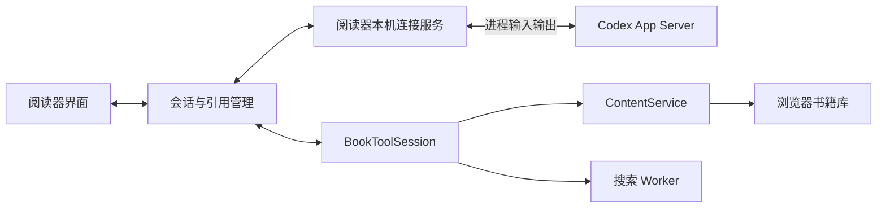

# 本地 Agent 接入设计

日期：2026-11-06。状态：主要流程已实施并完成真实订阅验证。下文保留设计约定；实际版本适配、验证结果及已知限制见末尾“实施记录”。

## 目标与范围

首版接入本机 Codex，使用 Codex 官方管理的 ChatGPT 登录，供个人电脑上的阅读器执行划词解释和带引用的书籍问答。保留现有直接 API 和兼容接口服务连接；用户主动选择后使用，不在连接失败或额度不足时自动切到付费 API。

以后按需求增加其他 Agent。首版只建立小型适配接口，不引入多 Agent 调度、通用 Agent 框架、终端界面或插件市场。

订阅登录、模型可用性和额度由 Codex 及账号权益决定。连接程序在本机运行，模型处理仍可能在云端；主动提交的问题和所需原文片段会离开本机。不得把“本地 Agent”描述为离线模型或无限免费调用。

## 现状与新增内容

| 内容 | 接入前实现 | 本轮设计 |
| --- | --- | --- |
| 模型连接 | 浏览器直连 Chat Completions；本地 Agent 选项也要求兼容此协议 | 增加明确的“本机 Codex（订阅登录）”选项 |
| 本机服务 | Vite 开发/预览服务及翻译转发 | 在同一地址增加受限的 Agent 连接入口 |
| 工具 | `BookToolSession` 执行四个书籍工具并核算预算 | 复用执行器，通过双向通道交付工具请求和结果 |
| 问答 | `askBook` 驱动 Chat Completions 工具循环；界面历史仅内存 | Codex 自行驱动工具循环，阅读器统一核验工具结果与引用 |
| 书籍与位置 | 浏览器 Dexie、ContentService、搜索 Worker、原文 CFI | 沿用；不为 Agent 导出整本书到文件系统 |

## 结构与职责

阅读器页面和本机连接服务使用同一来源的 WebSocket；后端以 `stdio` 启动和连接 `codex app-server`。不把 Codex 的原始协议直接暴露给网页。官方将 WebSocket 传输标为实验性，因此首选进程输入输出；网页使用的 WebSocket 是阅读器自己管理的通道，与 Codex 的 WebSocket 传输无关。

浏览器负责书籍、选区、工具执行、原文定位和记录保存。本机服务负责 Codex 进程、协议转换、登录状态、事件路由、断开和取消；只保存连接所需的内存状态，不复制书籍库或登录凭据。

现有 `Complete` / `modelClient` 留给 Chat Completions 路径。Codex 使用原生会话与动态工具，不假装成 `/chat/completions`。从 `askBook` 抽出可复用的预算与引用核验，避免维护两套书籍规则。

## Agent 适配边界

统一使用阅读器自己的会话 ID 和事件类型。第三方 thread/turn ID 仅由适配层管理，上层不依赖 Codex 字段。

适配器职责包括：检测与连接、读取登录状态、分页获取模型及每个模型的 effort 选项、报告阅读 Chat 能力、开始或恢复会话、提交带模型/effort/阅读策略的一轮请求、返回工具结果、中止、关闭。共用事件至少包含连接状态、模型能力更新、回答增量、工具请求、用量、完成、取消和失败。工具请求与回包均携带会话、轮次和唯一调用 ID。

用能力字段表示是否支持工具、流式输出、恢复、用量查询和受限阅读 Chat，并携带模型列表及其支持的 effort；上层不假设不同 Agent 共用同一套 effort 枚举。缺少工具能力时只能提供划词解释，不开放带检索的书籍问答；无法报告的用量显示“不可用”，不估算订阅余额。

第一版仅实现 `CodexAdapter`。以后增加其他 Agent 时实现同一接口，保持 `ContentService`、检索、引用卡片和学习记录不依赖具体服务商。是否引入 ACP，等第二种 Agent 的实际需求确定后再决定。

## 连接、登录与启动

1. “启动阅读器”继续使用固定 `http://127.0.0.1:4173/`，保留原浏览器数据。连接入口随本机服务准备，Codex 在选择或检测该连接时按需启动；只阅读时无需启动 Codex。
2. 检测可执行文件，允许用户选择其绝对路径；启动参数由服务固定，不接受网页提交任意命令。Windows 后台运行，不弹出终端窗口。
3. 完成 `initialize` / `initialized` 后读取 `account/read`，再通过 `model/list` 分页查询实际可用模型和各自支持的 effort，填充联动选择器；不固定一个账号未必能用的模型名称。
4. 订阅选项仅在确认使用 ChatGPT 登录及受支持的官方模型提供方后可提问。若检测到 API key、自定义提供方或无法确认计费路径，明确提示，要求用户修正连接或主动改选 API。不得把“Codex 已启动”当成“订阅已可用”。
5. 未登录时提供“登录 Codex”，由 Codex 管理的官方浏览器登录流程完成；阅读器不读取、复制或修改 `auth.json`，不向页面返回访问令牌，不自动退出其他客户端的账号。
6. 设置展示未检测到、待登录、连接中、可用、版本不兼容和连接失败。若支持额度查询，显示提供方返回的额度与重置时间；错误提示提供重试或重新登录入口。
7. 连接进程归本机服务所有；重连不重复创建进程，关闭只结束本服务创建的子进程，不结束 Codex 桌面应用或用户独立运行的进程。

保留直接 API 和原“兼容接口本地服务”作为独立选项；相关密钥仍只在页面会话内。可持久化连接选择、模型、effort、阅读 Chat 策略及阅读器会话映射，不持久化 API 密钥或 Codex 登录令牌。

## 模型列表与 effort 选择

订阅连接的设置区和 AI 输入区提供“模型”“推理强度（effort）”两个联动控件，并显示固定的“Chat · 阅读对话”模式标记。模型与 effort 均使用 Codex 返回的数据，不沿用现有接口的手填模型名称方式。

- 认证状态确认后调用 `model/list`，使用 `includeHidden: false`，沿 `nextCursor` 读取全部分页。显示 `displayName` 和可用描述，以 `model` 字段作为发起请求的模型标识；保留 `id` 作列表标识，不假设二者始终相同。
- 模型列表加载、为空或失败时分别显示状态；提供刷新入口，不用硬编码模型冒充当前账号的可用列表。重新登录、账号/提供方改变、Codex 重连或版本改变后重新获取，不跨身份复用缓存。列表返回不保证每次调用都有足够额度，实际请求失败仍需明确显示。
- effort 选项来自该模型的 `supportedReasoningEfforts`，保留服务端值及描述；初始值使用 `defaultReasoningEffort`。协议枚举只用于解析，不能把所有枚举值都当作该模型可选项；不固定为 low/medium/high，也不假设“默认”等于 medium。
- 首次连接使用返回的默认模型；恢复已有选择时先校验模型和 effort 仍有效。用户主动换模型时，只在新模型支持原 effort 时保留，否则显示改用新模型默认 effort 的提示。恢复时若原模型不可用，则暂停提交并让用户重新选择，不静默换模型或计费路径。
- 单一 effort 可显示固定值；服务端没有报告 effort 能力时显示“由模型决定”，不伪造选项或发送未知值。列表外的手填模型与隐藏模型不作为订阅模式的默认入口。
- 阅读器保存连接级默认模型/effort和每个对话的选择；临时划词会话使用当前界面选择。每条已提交请求记录模型、effort 和阅读策略快照，修改选择只作用于下一轮，不改变正在生成或已经保存的回答。
- 发起每轮前，本机服务再次校验所选组合属于当前连接的能力列表，再映射到 `turn/start.model` / `turn/start.effort`。如果使用 `collaborationMode`，其 settings 中的 model/`reasoning_effort` 必须与界面一致，因为该字段会覆盖普通 model/effort 参数。服务端拒绝或要求重启时明确提示，不悄悄丢弃 effort 或降级模型。
- 模型和 effort 的改变不修改用户全局 Codex 配置，也不影响其他客户端的对话；更高 effort 不增加阅读会话的工具权限或原文预算。若某组合要求阅读 Chat 不允许的执行能力，应禁用该组合并说明原因。

## Chat 模式：阅读对话策略

首版固定为“Chat · 阅读对话”，面向解释、讨论和原文查证；不提供 Agent 执行、Plan 或自动任务模式切换。Chat 可以按需调用四个只读书籍工具以支撑引用；“只聊天”不意味着取消原文检索。划词解释保持不注册书籍工具的临时对话。

必须区分阅读器产品模式与上游协议模式。2026-11-06 在本机 `codex-cli 0.167.0-alpha.3.2` 生成的协议类型中，`ModeKind` 仅为 `default | plan`，不存在 `chat` 值；因此不能发送虚构的 `mode: "chat"`，也不能把 `collaborationMode: default` 或文件系统 read-only 单独当成 Chat 权限边界。

Codex 适配层使用普通非 Plan 对话配置，配合专门的阅读指令、四个动态书籍工具、禁用其他执行入口和受限权限来实现 Chat。是否需要显式指定 Default，以及具体隔离参数，由对应 CLI 版本的能力验证决定；不继承此前任务的 Plan 或执行策略。若以后其他 Agent 提供原生 Chat/Ask 模式，则优先映射到它，同时保留阅读器的工具边界。

阅读 Chat 的行为约定：

- 直接回答读者问题；需要证据时查阅书籍。避免把讨论扩展为编程任务、电脑操作或持续自动执行的目标。
- 只有 `getOutline`、`searchBook`、`readPassage`、`readSection` 可供问答调用；不能运行命令、读写电脑文件、调用额外 MCP/插件、调度执行型子 Agent或修改笔记。
- 默认指令服务于中文解释、语言学习和有依据的书籍讨论；模型/effort 选择与阅读模式分别管理，换模型不能把会话变成执行模式。
- 新建、恢复、重连和每轮提交都检查阅读策略；后端强制执行白名单，界面模式标签只展示真实能力。无法建立隔离时禁止提问，不能靠提示词或按钮名称宣称已启用 Chat。

设计阶段的上述本机类型检查只确认协议形状；后续真实账号模型列表和 Chat 验证结果见末尾实施记录，二者不可混为同一类证据。

## 书籍问答与双向工具

一轮请求的流程：

1. 捕获当前书籍哈希、会话、选区、模型、effort、阅读 Chat 策略和请求代次，创建独立 `BookToolSession`。
2. 在 Codex 会话注册 `getOutline`、`searchBook`、`readPassage`、`readSection`；适配器把名称转换到阅读器专用工具命名空间。
3. 页面经本机服务提交问题与明确标注的选区数据。选区属于待分析资料，不作为可执行指令。
4. Codex 通过 `item/tool/call` 请求工具；本机服务路由到拥有该请求的页面。浏览器校验书籍、轮次、调用 ID 和参数后执行现有工具，返回原文及引用编号。
5. Codex 根据结果继续查阅或回答。回答可逐步显示，只有该轮成功完成、引用核验通过且仍属于原请求时，才进入已完成历史；不把半截流式文本保存为学习记录。

每轮沿用最多 8 次工具调用、累计 30,000 字符原文，搜索摘录、选区和额外注入的上下文一并计入。重试投递不重复执行同一个调用或重复扣预算；计数仅在新用户轮次开始时重置。续聊历史不计作本轮新增原文，但仍占模型上下文和订阅用量。

预算到限后，阅读器拒绝进一步读取，并要求依据已有材料回答；若模型继续请求工具，终止该轮。任何未知工具均拒绝。导航、写笔记和保存解释仍由读者触发。

划词解释使用独立的临时会话，只发送选区及有限周边上下文，不污染书籍主对话；取消和保存规则沿用现有行为。

## 会话、引用与隔离

- 会话归属为浏览器阅读器实例、书籍哈希、Agent、账号/提供方身份和会话 ID。每本书默认恢复最近会话，提供“新建对话”；更换账号或 Agent 后新建会话，不静默沿用旧上游会话。
- 页面内存和本机服务共同绑定会话拥有者，不允许另一标签页接管正在执行的轮次。首版限制同一连接一次仅运行一个生成请求，重复操作显示忙碌状态。
- 切书、取消、关闭页面或连接断开后，使旧请求代次失效，中止上游轮次，释放待处理工具请求。拒绝迟到的结果，不保存到新书；恢复后重新发起用户请求，不后台重放。
- 浏览器是会话展示记录和引用来源的拥有者；Codex 持有其原生对话。恢复时先核对身份和上游会话状态；会话不可恢复时保留本地历史，明确新建会话，不声称已恢复上下文。
- 引用编号在同一对话内单调递增，不每轮重用 `R1`。每条回答保存实际原文、章节和 Locator 快照；本轮最终回答只认可本轮实际返回的引用，引用旧材料时需再次读取。模型编造或复用历史编号标为未验证。
- 流式回答不提前生成可点击引用；完成后由阅读器依据工具台账生成卡片。点击引用才导航，工具读取始终不移动页面。

新增会话存储采用 Dexie 增量版本，增加 `agentSessions` / `agentMessages`，保留现有四张表。会话保存当前模型、effort 和阅读 Chat 策略；消息保存提交时的配置快照、完成状态、文本和引用快照，不保存推理过程、令牌或原始协议日志。支持删除阅读器内的会话；界面说明这不等同于删除 Codex 自己保留的历史。

首版不改变现有 version 1 备份格式，AI 对话不纳入该备份；在导出说明中明确范围。批注、学习记录和进度继续按原规则备份，后续若要备份对话再设计格式升级。

## 本机接口与权限

只监听 `127.0.0.1`；校验 Host 和精确 Origin，WebSocket 握手和后续控制消息要求阅读器会话凭证。凭证不放 URL、日志或个人备份；限制消息大小、并发和空闲连接。网页不能指定任意进程、目录或原始 JSON-RPC 方法。

复用登录不等于复用用户全部运行配置。阅读场景应禁用非书籍工具及用户配置的 MCP、插件、hooks 等可执行入口，使用专用工作目录和最小权限。只读文件系统权限仍可能允许读取其他文件，不能单靠“read-only”或提示词宣称实现工具隔离。

实施时依据已安装 CLI 的官方协议确认上述隔离选项，并验证命令、文件和外部连接器均无法被调用；无法做到时将版本标为不兼容，不降级成可任意操作电脑的模式。任何额外权限请求均拒绝并终止相关操作。

前端渲染回答使用现有受限显示方式，书籍内容和模型输出均不作为脚本或指令执行。日志只记录脱敏后的生命周期、错误码和版本，不写入原文、完整问题或认证信息。

## 故障与兼容性

取消必须送达上游 `turn/interrupt`；若未收到终止确认，界面不能声称远端已经停止，用超时清理本服务的连接和状态。断线不自动重发已提交的轮次，以免重复生成和消耗额度。

将连接、等待工具、生成和总轮次超时分开处理，不机械复用现有 API 的 90 秒单请求超时。首版可先采用连接 15 秒、工具等待 30 秒、生成无活动 120 秒、整轮 5 分钟的可调整默认值；超时与失败均保留完整的既有记录。

`dynamicTools` 等字段属于实验性接口。实施时记录本机 CLI 版本，用该版本生成或核对类型，维护已实测版本范围。通过握手、能力与工具回调实测后才启用问答，不单凭版本字符串判断。对不兼容版本给出可操作提示，不静默省略检索或引用验证。

## 实施顺序与验收

| 阶段 | 交付 | 必须验证 |
| --- | --- | --- |
| A：连接 | 本机入口、Codex 适配器、状态与登录、模型/effort 联动选择、阅读 Chat 策略 | 未安装/未登录/API 登录/协议不兼容均准确显示；模型分页/刷新、effort 默认/换模型失效处理正确；无凭据进入网页或日志 |
| B：解释 | 临时会话、流式解释、取消和保存 | 真实订阅请求成功；半截、失败和迟到结果不保存；不会调用非书籍工具 |
| C：问答 | 双向工具、共享预算、最终引用核验 | 检索未显示章节而不导航；预算、未知工具、伪造引用和工具重复投递处理正确 |
| D：续聊 | 按书会话、历史和新建对话、恢复 | 刷新续聊、模型/effort 恢复及下轮切换、Chat 策略不被覆盖、换书/账号/标签页隔离、原文引用跨轮不冲突、旧数据库无损升级 |
| E：交付 | 启动整合、说明和版本兼容记录 | 原阅读/批注/API 路径回归；真实 Codex 实测与模拟测试分开记录 |

按实际变更运行必要的单元和浏览器验证。至少一次使用真实 Codex 订阅登录完成“解释 → 检索 → 回答 → 引用跳转 → 续聊 → 取消”的验收；测试替身只能验证协议与状态，不能证明订阅或真实模型可用。

新增实测要求：用真实账号拉取模型列表，至少选择两个实际支持的 model/effort 组合发起请求，确认界面选择进入上游参数；若账号仅提供一个组合则记录限制，不冒充完整通过。验证生成途中改选择仅影响下一轮；恢复旧会话和切换模型不覆盖 effort。通过包含“帮我执行命令/修改文件”的请求验证阅读 Chat 的工具边界，并确认正常原文检索仍可用。

## 参考与取舍依据

2026-11-06 调研。以下社区项目已阅读说明和关键连接代码，未安装运行；采用设计思路，不整包引入，若后续复用代码须保留其许可证要求。

- [官方 Codex App Server](https://learn.chatgpt.com/docs/app-server)：原生会话、stdio、登录、取消和实验性动态工具；实施时以实际安装版本核对协议。
- [官方认证说明](https://learn.chatgpt.com/docs/auth)：区分订阅登录与 API 登录，不假设已安装 CLI 就已有可用订阅。
- [Codex Panel](https://github.com/murashit/codex-panel/tree/a3fd33226b3c700e8a160e1181645d8539ab2096)：借鉴 stdio 连接管理、应用动态工具和版本兼容记录。
- [Codex Workbench](https://github.com/lianyhai-ai/obsidian-codex-workbench/tree/01eff87eed0b01686f899b36a08d3d186ace63ab)：借鉴选区、周边上下文、学习场景和可点击引用；不采用其 Codex WebSocket 连接方式。
- [Obsidian Agent Client](https://github.com/RAIT-09/obsidian-agent-client/tree/3d069c91636588be4e65d955e670403a9ea642d8)：借鉴能力适配和会话事件；ACP 留待扩展其他 Agent 时评估。

## 实施记录

- 已实现同源本机连接、Codex 登录检测与官方登录链接、分页模型列表、按模型联动的 effort、流式阅读 Chat、临时划词解释、四个书籍工具、预算与引用核验、按书对话保存/切换/恢复/删除，以及在途取消和迟到结果隔离。兼容接口和直接 API 继续独立使用。
- 当前精确启用已实测的 `codex-cli 0.167.0-alpha.3.2`；其他版本需先核对隔离策略再加入兼容范围。该版本使用命名 `permissions` 配置，已不接受旧文档中的 `readOnly.access`；账号会话方法为 `accountSession/list`。
- 该版本的若干原生工具由模型能力元数据启用，不能仅靠功能开关关闭。实现先通过标准连接获取实际模型列表，再读取非凭据的模型能力缓存，写入 `.cache/reader-agent/reading-models.json` 作为独立的受限能力副本；不改用户原缓存。关闭 shell/apply_patch/代码执行能力及额外工具开关，并核对有效配置。`model/list` 的账号列表和 effort 仍来自正常账号发现连接，不由本地副本伪造。
- Windows elevated helper 需要自身的根目录读权限；使用专用只读 profile 和无命令网络权限，同时移除模型的文件/执行工具入口。以实际能力禁用、配置核验和工具白名单共同实现 Chat，不把只读文件系统当成独立隔离保证。Ultra 涉及多 Agent，显示为阅读 Chat 不支持。
- 原有 Dexie v1 数据增量升级到 v2；AI 对话不进入旧备份。取消轮次实际读过的引用编号也会保留，防止续聊时重复使用。会话的策略指纹按稳定键排序计算，避免配置字段顺序变化导致正常重连无法恢复。
- 已用当前订阅获取 8 个可见模型，使用 `gpt-6-luna` 的 low/medium 完成原创文本解释、原文工具与引用、续聊、拒绝文件任务和取消测试。专项浏览器测试与真实模型测试分开记录；未把模型口头拒绝当成唯一权限保证。
- 完整旧浏览器套件有 9 项失败，在修改前的 HEAD 快照、独立端口和独立测试资料中可复现同样的 9 项；主要仍检查旧选区面板、学习模式及正文插入行为。未通过改变阅读功能或降低断言来掩盖这些旧问题。详细数量与最后验证结果见开发记录。
